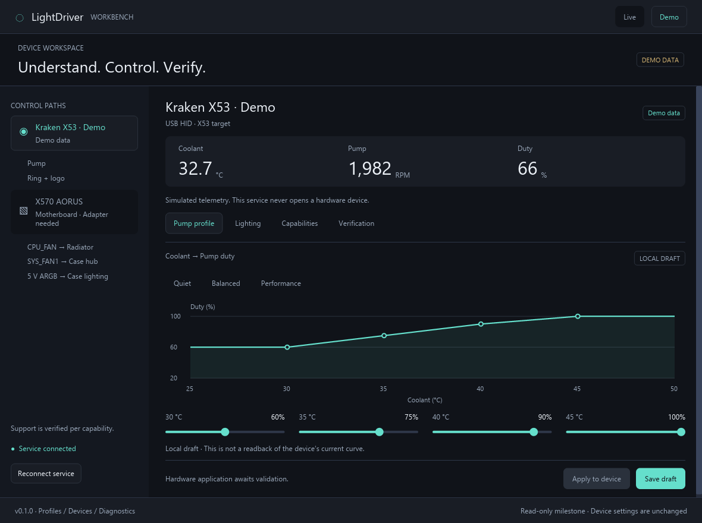
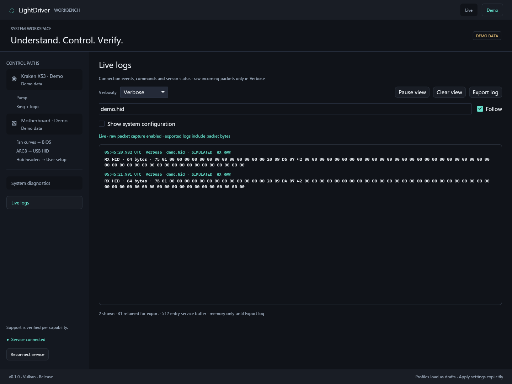
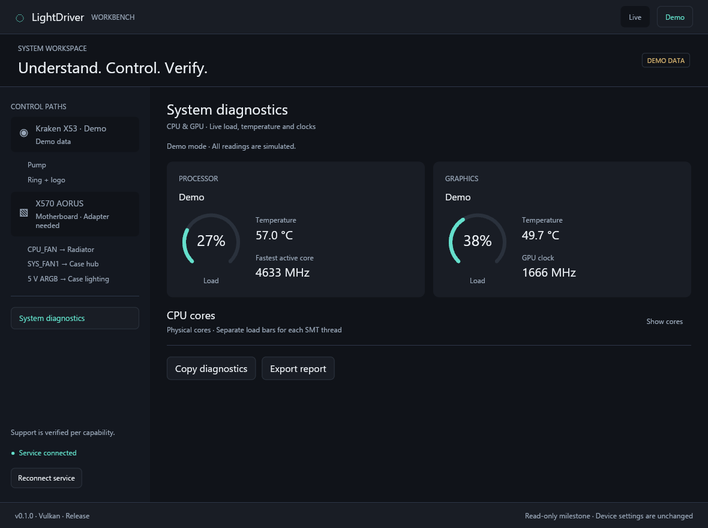
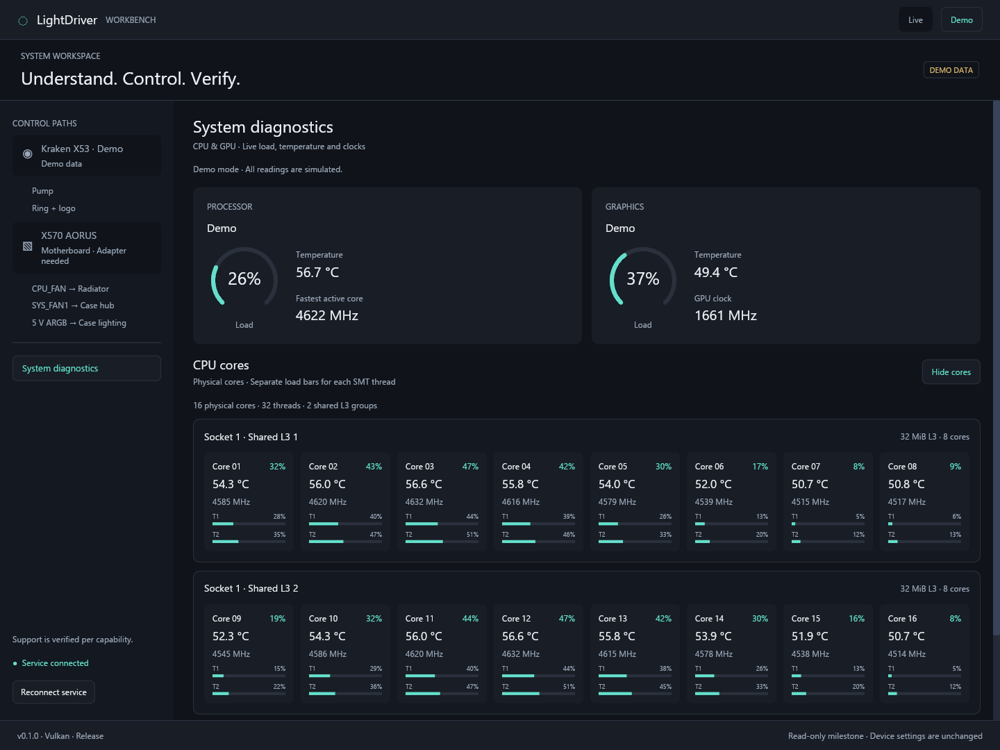

# LightDriver

A native Rust workbench for understanding, controlling, and verifying PC cooling and lighting. The desktop uses **Iced**; an independent local Rust service owns device access.

**Early development: device control is explicit and physical write validation is pending.** Monitoring starts without setting changes. Enable control, then Apply a validated pump curve or lighting effect. Demo exercises the same command path without opening hardware. See [control behavior and limits](docs/control.md).



The screenshot is the running native application in demo mode. See the [verification record](docs/verification.md) for measured hardware evidence and remaining limits.

## Current support

| Path | Current behavior |
| --- | --- |
| NZXT Kraken X3 USB HID | Discovery, coolant temperature, pump RPM/duty; explicit control enable |
| Kraken pump curve | Editable coolant curves stored on the device; explicit 100% pump action |
| Kraken ring and logo | Separate or combined static, breathing, spectrum and off effects |
| Radiator / case fans | BIOS fan control initially; the X53 does not expose fan speed control |
| Recognized GIGABYTE ITE 8297 boards | Rust HID adapter for D_LED1/D_LED2 native effects; no vendor SDK required |
| Passive PWM/ARGB hubs, including LANCOOL 216 | User-assigned motherboard header; group lighting, with no independent per-fan assumption |
| Profiles / Setup | Named local profiles, validated import/export, per-user wiring |
| Live logging | Error/Warning/Info/Debug/Verbose, system context, filter/pause/follow and local JSON export; raw packets only in Verbose |
| Verification | Command receipts and local self-reported hardware test reports; writes remain physically unverified |

Motherboard fan curves remain controlled by BIOS. Research has identified a firmware-variable candidate for saving curves from Windows; complete curve encoding, write permission and reboot behavior remain unverified. See the [BIOS persistence investigation](docs/firmware-fan-persistence.md) and [controller-curve feasibility report](docs/motherboard-curves.md).

X53, X63, and X73 share a USB identity, so discovery identifies the **Kraken X3 family**, rather than claiming to distinguish the radiator model. Both known X3 product IDs are recognized; support beyond the reference X53 needs hardware testing.

The motherboard name is discovered from Windows inventory. RGB control also checks the USB vendor/product ID, HID usage, known board layout and controller identity. Initial ITE 8297 layouts cover X570 AORUS ELITE, ELITE WIFI, PRO, PRO WIFI and ULTRA. Other boards need a documented adapter/layout; they do not receive guessed commands. Header assignments have no global defaults and are tied to the user's detected board identity.

## Run on Windows

Install stable Rust with the MSVC toolchain and Visual Studio Build Tools with **Desktop development with C++**. Then:

```powershell
cargo build --workspace --release --locked
.\target\release\lightdriver-desktop.exe --demo
```

Double-click `LightDriver.cmd` for the optimized app. The footer shows the active renderer and build profile. Debug builds are intended for development, not responsiveness assessment.

Omit `--demo` for live monitoring:

```powershell
.\target\release\lightdriver-desktop.exe
```

The desktop connects to the existing service or starts `lightdriver-service.exe` from the same directory. Build the whole workspace so both executables are present. The service runs without a console window when the UI starts it, and continues after the UI closes. No Windows startup task or system service is installed.

For a foreground service with visible diagnostics:

```powershell
.\target\release\lightdriver-service.exe
# Ctrl+C stops it.
```

For a background service started by the UI, stop its process using Task Manager when finished. Live and demo services use separate local endpoints; demo never opens hardware.

Drafts and exported reports are saved under `%LOCALAPPDATA%\LightDriver`. Use `--data-dir <directory>` to select another location. Drafts are validated when loaded and saved. Saving a draft does not apply it to a device.

### Read-only diagnostics

```powershell
# Poll once without leaving a service running.
.\target\release\lightdriver-service.exe --once
# Read a running service.
.\target\release\lightdriver-service.exe --snapshot
# Same operations with simulated data.
.\target\release\lightdriver-service.exe --demo --once
```

Polling does not initialize devices or send setting commands. Enable Kraken control explicitly initializes its status stream; Enable RGB control queries the ITE identity without resetting its lighting. Applying settings is a separate action. Read/open errors are surfaced without stopping another controller. Samples older than five seconds are hidden as live readings.

## Architecture

```text
Iced desktop ── bounded, versioned local IPC ── Rust service
                                                 │
                                           Rust adapters
                                                 │
                                             USB / board
```

| Crate | Responsibility |
| --- | --- |
| `lightdriver-core` | Device/capability models, telemetry freshness, curve/draft validation |
| `lightdriver-ipc` | Versioned length-prefixed JSON over local sockets; Windows named pipes; bounded frames/timeouts |
| `lightdriver-devices` | Windows Kraken / ITE HID adapters and isolated demo adapter |
| `lightdriver-monitoring` | Read-only CPU topology/load/clocks, optional AMD CPU SDK and AMD/NVIDIA/Intel GPU collectors |
| `lightdriver-service` | Single owner per user/mode, serialized polling/commands and bounded receipt cache |
| `lightdriver-desktop` | Native Workbench, explicit Apply, profiles, wiring and evidence export |

All first-party runtime code is Rust. Windows HID uses `hidapi`'s native Windows backend; the UI tries Iced's WGPU GPU renderer first and uses Tiny Skia as a software fallback. The local API contains snapshots, typed device commands, separate bounded log batches and the explicit CPU-sensor handoff. The service validates mode, device, capability, payload and deadline. It serializes commands with polling, retains duplicate receipts for the full request deadline, and never retries unknown hardware outcomes.

The initial service is a **per-user background process**, not a privileged Windows Service. Remote control, privileged motherboard drivers, automatic startup, and installer distribution need separate design decisions. Windows IPC grants access to the current account, administrators and SYSTEM, with remote pipe clients disabled. CPU sensor elevation is an explicit per-session action. Hardware control is explicitly enabled per connected device; saved profiles never apply automatically. Remote control requires a separate authorization design.

## Development

```powershell
cargo fmt --all -- --check
cargo clippy --workspace --all-targets --locked -- -D warnings
cargo test --workspace --locked
```

Windows CI runs these checks and builds both executables. Tests cover wire packets/faults, ITE identity/header masks, telemetry freshness, curve constraints, profile import/replacement, wiring identity, demo isolation, bounded IPC, duplicate/expired commands, real service command lifecycle and UI guards. Tests use synthetic data and do not open hardware. Live hardware support currently targets Windows; other platforms can use the demo adapter but have not been validated.

Native rendering can be captured for review:

```powershell
.\target\release\lightdriver-desktop.exe --demo --capture .data\workbench.png
.\target\release\lightdriver-desktop.exe --demo --tab lighting --capture .data\lighting.png
```

`--tab` also accepts `capabilities`, `verification`, `diagnostics`, `setup` and `logs`. Use `--cores` to expand the physical-core diagram in Diagnostics. The app captures its native window after three seconds and exits; the independent service remains running.

For rendering checks, `--size 980x720` selects the minimum supported window size, `--device motherboard` selects the discovered motherboard, and `--no-autostart` prevents the initial connection attempt from launching a service.

## Live logs and tester reports

The **Live logs** sidebar opens an in-app stream with **Error, Warning, Info, Debug and Verbose** levels. Info includes system configuration and adapter status. Verbose alone collects and displays raw incoming HID bytes and decoded sensor samples; reducing verbosity removes retained raw entries. The stream supports search, pause/resume and following.

**Export log** saves a new local JSON report with retained entries, OS/app details, CPU/GPU identities, topology, memory, motherboard/controllers, sensor adapters, renderer and saved wiring. Nothing is uploaded automatically. The service uses a bounded memory buffer and separate IPC log batches to keep telemetry/rendering work independent. See [logging behavior and report contents](docs/logging.md).



## Next milestones

1. Physically validate pump response, ring/logo and ARGB effects, competing controllers, unplug/reconnect and sleep/power-cycle behavior.
2. Expand documented device layouts and vendor adapters using tester reports.
3. Add Intel CPU package temperature through a supported vendor path.
4. Decide privileged service installation, startup and remote access separately.

## Protocol references

The Kraken status layout and identifiers were checked against the [Linux Kraken 3 driver](https://github.com/torvalds/linux/blob/master/drivers/hwmon/nzxt-kraken3.c) and [liquidctl X3 documentation](https://github.com/liquidctl/liquidctl/blob/main/docs/kraken-x3-z3-guide.md). The Rust parser is independently implemented. These references are not runtime dependencies.

## License

A project license has not yet been selected.

## Rendering and performance

WGPU is the default renderer; Tiny Skia is retained as a fallback. The app caches curve and ring geometry until their values or dimensions change. Normal operation does not run a continuous animation loop. Diagnostics include the active renderer and adapter.

To explicitly troubleshoot with software rendering, set `ICED_BACKEND=tiny-skia` in the launching shell. Remove that override to restore GPU-first selection. Iced also supports `ICED_BACKEND=wgpu,tiny-skia` as an explicit ordered preference.

For a bounded synthetic native workload (local draft sliders, scrolling, and resizing, no hardware commands):

```powershell
$benchmarkApp = Start-Process .\target\release\lightdriver-desktop.exe -ArgumentList '--demo --benchmark .data\performance.json' -PassThru -WindowStyle Hidden
$benchmarkApp.WaitForExit(20000) # Wait for the UI; the independent service continues.
```

The JSON records redraw-request intervals after a two-second warmup, not mouse-to-display latency. GPU presentation and software presentation have different synchronization behavior, so these intervals are not a direct renderer speed comparison.

## System diagnostics

The Diagnostics tab focuses on CPU/GPU load, temperature and clock speed. Cached radial bars show load; Show cores expands physical-core tiles with SMT bars, OS clocks and shared-L3 grouping for CCX-like layouts. AMD CPU package temperature uses an optional installed vendor SDK through the local Rust service; Enable CPU sensors requests Windows UAC while keeping the UI at normal permissions. Per-core tiles show load and reported clock. Intel CPU package temperature integration remains pending. GPU adapters cover AMD ADLX, NVIDIA NVML and Intel Level Zero Sysman, subject to installed APIs. See [coverage and semantics](docs/diagnostics.md).

After updating from an older build, restart the local service: protocol version 5 includes typed commands, control capabilities, receipts and bounded logging. Windows CI builds an optimized portable app artifact containing both executables and the launcher.




