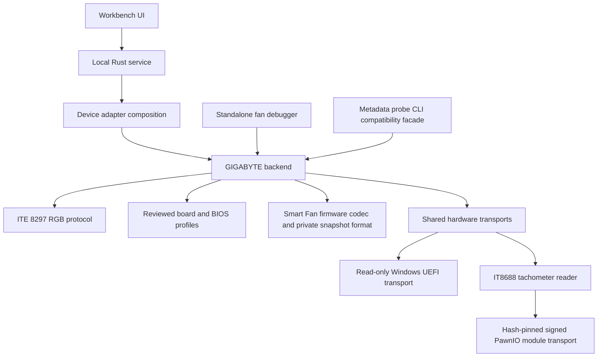

# Motherboard adapter architecture

The service and standalone firmware debugger both use `lightdriver-gigabyte::GigabyteBackend`. The debugger remains a separate executable and download; it is not embedded in Workbench. Construction and support discovery are passive. Service polling performs RGB discovery; it does not automatically open PawnIO, read firmware, request UAC or apply curves.

## Crate responsibilities

| Crate | Responsibility |
|---|---|
| `lightdriver-core` | Vendor-neutral `DeviceAdapter` and `MotherboardBackend` contracts, board/BIOS identity, capability descriptions and RPM models. No hardware access. |
| `lightdriver-hardware` | Windows registry inventory, controller-conflict checks, bounded UEFI reads with serialized temporary privilege restoration, private create-new file/hash primitives, PawnIO module verification/transport and IT8688 tachometer decoding. No vendor profile selection, firmware setter or fan-setting writer. |
| `lightdriver-gigabyte` | RGB packets/controller identity, board/BIOS profile selection, channel mapping, Smart Fan format, complete private snapshots/comparison, partial curve/restore previews and initial recovery. Exposes the same `GigabyteBackend` to both consumers. |
| `lightdriver-devices` | Composes the Kraken adapter with the GIGABYTE backend for the service. It does not implement GIGABYTE protocols. |
| `lightdriver-firmware-probe` | Keeps the existing executable/CLI and library import compatibility; delegates to the GIGABYTE implementation. |
| `lightdriver-fan-debug` | Native UI, asynchronous operation/session handling and explicit capture/comparison/RPM CLI. No Windows hardware implementation or independent board map. |

`MotherboardBackend` keeps an associated firmware inspection type: each firmware family can use its own codec and report instead of adopting GIGABYTE offsets or forcing all vendors into one raw format. Common identity, support and fan-reading models are shared. This is compiled Rust composition, not an executable plugin loader or a facility for arbitrary NVRAM writes.

## Independent support gates

RGB layout recognition covers the previously reviewed X570 ELITE/ELITE WIFI/PRO/PRO WIFI/ULTRA layouts. Actual control additionally requires an unambiguous ITE 8297 HID interface and explicit enable/identity query.

The provisional RPM channel map covers X570 AORUS ELITE WIFI only, followed by independent IT8688 chip/revision/bank/monitor checks. BIOS revision alone does not change chip recognition, and recognizing the chip does not establish another board's header mapping.

Live firmware inspection requires the exact reviewed X570 AORUS ELITE WIFI/F41c/18 August 2026 inventory before privilege or UEFI access. Its data must then satisfy the format checks. A BIOS update outside that profile disables firmware inspection, while independently supported RGB/RPM paths can remain available. Registry identity is not complete firmware attestation or authorization for writes.

`firmware_save`, `immediate_apply` and `reboot_retention_verified` remain false. There is no firmware setter, enabled restore action or persistent fan-curve IPC command. Unknown profiles never acquire these capabilities from another recognized component.

## Adding a motherboard family

1. Add a vendor crate implementing the shared contracts and register it in device composition. Reuse transports where their chip/API behavior is applicable.
2. Keep variable names, binary layouts, RGB commands, header/sensor maps and reviewed defaults in that vendor's adapter. Prefer a supported vendor API where available. Never infer compatibility from the manufacturer or chip name alone.
3. Add explicit profiles for reviewed boards/BIOS versions. Firmware transport/layout, RPM mapping and RGB recognition need separate evidence. Do not accept executable adapters or writable profiles from imported user snapshot files.
4. Provide a contributor guide for that BIOS UI: retain a private before snapshot, photograph original settings, change one confirmed case header, capture after, record exact values and restore through BIOS. Isolate subsequent experiments to one setting at a time.
5. Validate decoding, unknown-byte preservation, external write policy, backup recovery and selected-header restoration before implementing any writable capability. Then verify physical response, BIOS display, app exit, warm reboot, cold boot and resume separately.

For supported end users, the eventual flow remains automatic detection, a shared curve editor, explicit backup/save/readback, and a reboot requirement where verified. Manual BIOS capture is a development/contributor workflow, not a required normal editing step.

## Distribution and compatibility

CI packages Workbench and the fan debugger separately. The fan-debug archive includes its executable, optional metadata probe, launcher and public documentation; third-party drivers/modules and private sensor/firmware captures are excluded. The two archives statically link the shared Rust modules and need no extra LightDriver DLLs.

Private firmware snapshot schema remains version 1 with the same fields, identity order, name/GUID, complete payload, attributes and hashes. Existing saved before/initial snapshots can still be imported. The refactor adds no firmware or fan-setting write, no installed Windows Service and no automatic hardware polling/elevation.
