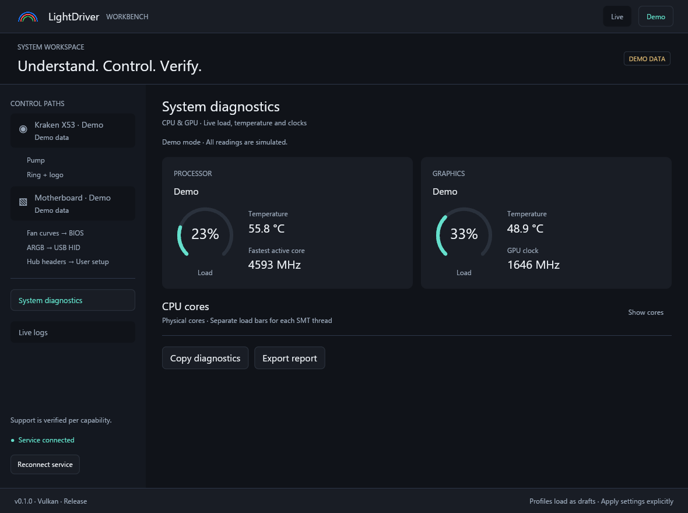
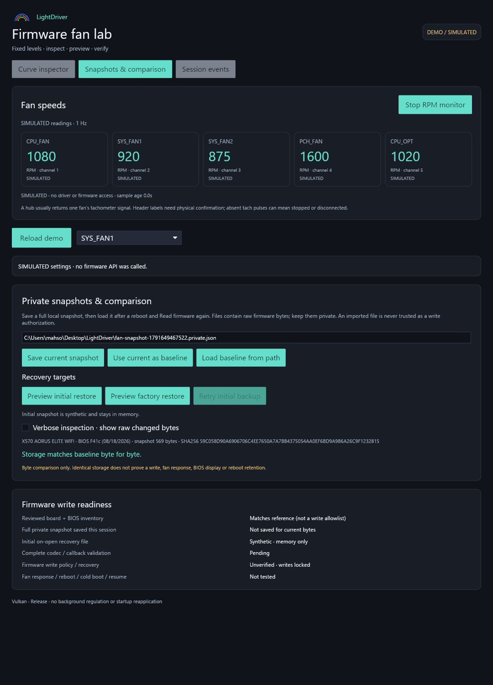

# Milestone verification

Updated on 10 October 2026, Windows x64, Rust 1.99.0.

## Software checks

- The complete Cargo workspace builds in release mode.
- Formatting and workspace Clippy with `-D warnings` pass.
- 78 automated tests pass, including actual demo service/named-pipe lifecycle tests.
- A second service cannot claim the same per-user/mode endpoint. Live clients cannot receive demo data.
- The CPU-sensor handoff policy denies demo and elevated processes. An actual demo IPC request is rejected without stopping its service.
- The account-specific Windows security descriptor is validated. Native verification confirms the ordinary UI can connect after UAC starts the elevated service.
- Missing, stale, future, invalid and offline readings remain distinct from valid zeros. Disconnects hide previous sensor values.
- Synthetic topology fixtures cover SMT, multiple processor groups, shared L3, hybrid efficiency classes, malformed records and overlapping affinities.
- A 256-core / 512-thread topology plus a full scalar sensor inventory fits the existing 128 KiB IPC frame budget. Basic diagnostics sends current readings without scalar history.
- AMD CPU MSVC x64 structures and virtual dispatch were checked against SDK 3.1.1.5478 headers/compiler layouts. Synthetic dispatch tests cover 1 Hz throttling, original timestamps, missing output fields and failures.
- Intel x64 ABI layouts, frequency structures and energy/activity counter semantics are checked with synthetic data.
- Demo never initializes system/vendor collectors or opens hardware. Invalid draft saves preserve the previous file.
- Real demo IPC commands cover explicit enable, curve/lighting submission, independent motherboard headers, release, unknown targets/channels, and duplicate identifiers. Synthetic tests cover expiry/cancellation/cache saturation, exact header commit masks and ITE identity-report quirks.
- Logging tests verify raw capture is Verbose-only, raw removal on downgrade, bounded retention/cursors/UTF-8 and escaped frame size, UI queued level changes/stale session responses, real demo IPC level switching, and actual local report export. System context accompanies bounded log batches; no file is saved without export.
- Profile import/export, legacy lighting defaults, user wiring identity and the explicit full-pump guard are validated. No header is assumed on a fresh install.

The earlier [Windows diagnostics CI run](https://github.com/mahsoommoosa42/LightDriver/actions/runs/37967280323) and [radial-load CI run](https://github.com/mahsoommoosa42/LightDriver/actions/runs/37968772415) passed checks, release compilation and portable packaging. Portable artifacts include both executables and the launcher. These runs predate the CPU SDK/topology update; its latest validation is recorded in the repository's Actions tab.

## Firmware fan lab checks

The independent debug app builds in release mode; full-workspace formatting/Clippy checks pass. Its UI was captured and inspected at 1080 × 1500 (snapshots), 1080 × 1900 (factory preview) and 920 × 680 with clearly marked synthetic RPM/settings. Content scrolls at smaller sizes. Firmware writes and restoration are disabled.

Tests cover firmware-format rejection, scalar offset decoding without mutation, sign-magnitude coefficients, case-only preview bounds/quantization, stale proposal invalidation, fixed IT8688 16-bit tachometers, enable bits, chip/revision recognition, bounded support-check arguments and new-report preservation, invalid/no-pulse counts, board identity rejection, module digest rejection and late/stopped RPM-session handling. Additional tests cover strict full-snapshot import/export, create-new preservation, corrupted/truncated/bounded imports, unknown-byte comparisons, origin/inventory rejection, case-only offline patches, initial anchoring across refreshes and header-scoped restore previews. Demo creates no automatic recovery file. No firmware getter or driver request is made by demo or RPM unit tests. The existing privilege-guard test checks process-local token handling only.

The optimized firmware probe still imports only the firmware type/getter APIs and no setter or driver I/O. The new debug executable imports the getter and DeviceIoControl for the separate RPM transport, with no firmware setter. Its Rust adapter has no PWM/curve-setting writes; necessary selector/configuration port outputs are documented in its README.

After normal installation, PawnIO 2.2.0 was observed running with a valid Microsoft Windows Hardware Compatibility Publisher signature. Normal-token driver access returned access denied. Elevated checks identified IT8688 revision 1 at I/O base 0x0A40 / Super I/O port 0x2E. The first run caught a revision-2-only recognition limit and an incorrectly applied older-ITE 8/16-bit mode rule. The adapter now accepts reviewed revisions 1/2 and uses fixed 16-bit counters for IT8688. Three subsequent samples returned three changing nonzero RPM readings and two no-pulse readings, with sample durations of 14–35 ms. Header wiring and independent RPM accuracy remain unverified; revision 2 has not been tested physically. Reports remain in ignored private .data storage. No fan setting or firmware variable was written and no reboot was performed.

Two explicit elevated firmware captures matched byte for byte (569 bytes; zero unidentified differences). Both case headers reported Normal mode with zero inactive manual fields. The GUI startup read also created a new initial snapshot in the private LocalAppData recovery folder, reloaded it, and matched the previous capture exactly. This validates local backup/comparison and preservation of the initial state, not firmware writes or restoration. No restart occurred.

The compiled F41c factory Normal reference was independently checked against the official image's case-header default/mode tables. The app proposes selecting Normal while preserving source/PWM/fan-stop settings. Both actual restore actions remain disabled.

Both native UIs were recaptured with the approved stem-free rainbow logo in their headers. Full and minimum-size fan-lab layouts were inspected; rendering remains Vulkan/Release. PE resource inspection verified icon ID 1 and matching packaged PNG bytes in both executables, alongside version resources. Shared branding caches pixels/image handles rather than decoding on every redraw.

## Native UI and performance

The running release Iced application was captured and inspected. Diagnostics now contains CPU/GPU radial load, temperature and clock cards with a physical-core toggle. Core tiles show separate SMT bars and shared-L3 groups; rows adapt to the window width. Simulated 8-, 16-, 24- and 64-core layouts were captured; the 8-core layout was checked at the minimum 980 × 720. Longer diagrams scroll vertically. Captures confirmed Vulkan GPU rendering. The pump, ring/logo, case-lighting and Setup screens were also captured at normal and minimum window sizes; longer content scrolls vertically. Live logs were captured at Info and Verbose, with system configuration expanded, and at the minimum window size.

The images below use simulated data. Live sensor captures remain private.

GPU rendering remains the default, software rendering the fallback. Geometry is cached and normal operation has no continuous animation loop. Earlier scrolling and resizing were reported smooth after the GPU/cache/release changes. Synthetic redraw intervals do not measure input-to-display latency.

## Read-only hardware evidence

The reference Kraken X3 adapter returned coolant temperature, pump RPM and duty without initialization or hardware-setting commands. Its USB identity identifies the X3 family rather than independently distinguishing radiator models.

AMD ADLX returned GPU temperature/load/power; Windows topology and performance counters returned physical cores, SMT loads and reported clocks. The AMD CPU SDK returned package temperature, active-core peak clock and PPT power after normal SDK installation and service elevation. The ordinary UI remained at normal permissions and displayed live readings through the updated pipe permissions. A handoff request to the elevated service was rejected. These observations establish working read paths, not independent accuracy calibration or broad model coverage.

## Remaining limits

- Individual-core temperature was removed from scope. The CPU card retains measured package temperature; core tiles show load and reported clock.
- Intel CPU temperature integration and physical NVIDIA/Intel GPU validation remain pending.
- Multi-group and hybrid CPU layouts are covered by synthetic tests; physical hardware validation and CPU hotplug remain pending.
- UAC cancellation recovery is covered by UI state logic; broader Windows account/session configurations and clean-machine deployment remain unverified.
- Pump/ring/logo and ITE 8297 header command implementations are present, with physical measured-response, competing-controller, sleep and power-cycle tests still pending. USB submission is not a hardware-verification claim.
- Board inventory and recognized USB-controller discovery have been observed with control disabled. The ITE identity query and setting commands have not been exercised on live hardware.
- Named local profiles and per-user header assignments are implemented. Stored-device readback and automatic restoration remain unavailable.
- Motherboard fan control remains in BIOS by design. Broader vendor/board/controller support requires documented adapters and layouts.
- Privileged Windows Service installation, startup automation and remote access are separate future architecture decisions.

Hardware support should be assessed per capability as testing becomes available.
