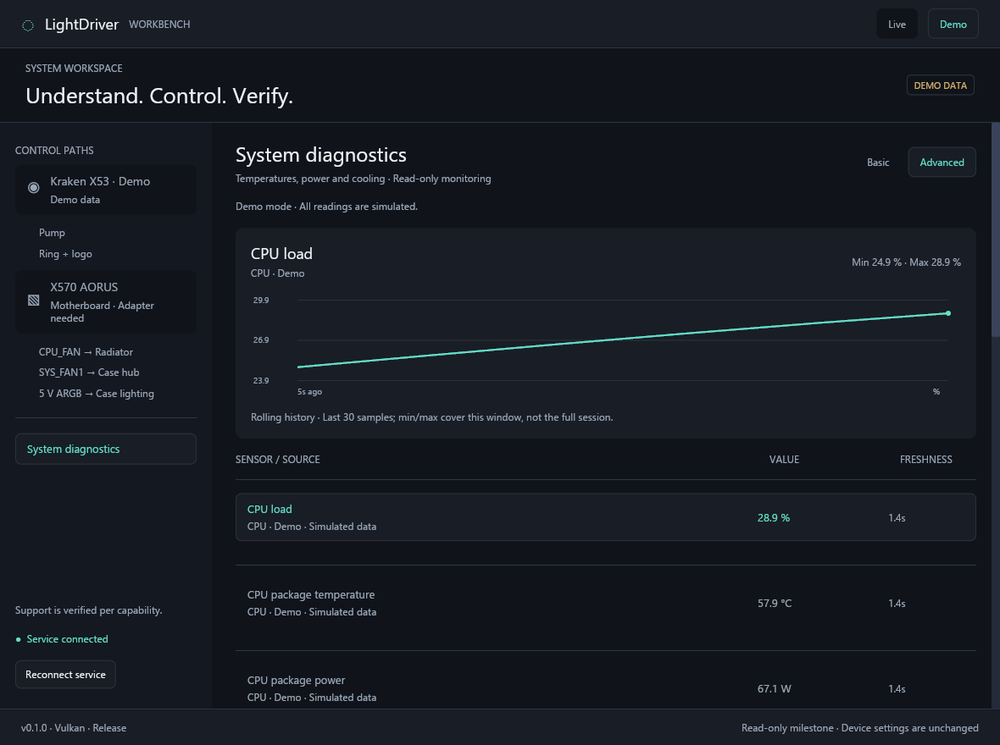

# Milestone verification

Verified on 9 October 2026, Windows x64, Rust 1.99.0.

## Software checks

- The full Cargo workspace builds in release mode.
- `cargo fmt --all -- --check` and workspace Clippy with `-D warnings` pass.
- 17 automated tests pass, including actual demo service/named-pipe lifecycle tests.
- A second service cannot claim the same per-user/mode endpoint. Live clients cannot receive demo data.
- Invalid draft saves preserve the previous valid file; replacement saves and reloads work on Windows.
- Missing, stale, future, invalid and offline sensor values remain distinct from valid zero readings. Disconnects hide the previous values and history.
- Sensor histories and IPC payloads are bounded. A maximum-size diagnostics fixture fits the 128 KiB transport limit.
- Intel x64 ABI layouts and counter units, first-sample, reset and zero-interval behavior are checked with synthetic data.
- Demo does not initialize vendor/system collectors or open hardware.

The [Windows CI run for the diagnostics milestone](https://github.com/mahsoommoosa42/LightDriver/actions/runs/37967280323) passed formatting, Clippy, all 17 tests, release compilation and portable artifact packaging. The artifact contains both executables and the launcher. These checks do not establish physical NVIDIA/Intel sensor coverage.

## Native UI and performance

Rendered and inspected the actual Iced windows: pump profile, lighting, capability matrix, verification, recorded motherboard target, offline state and Basic/Advanced Diagnostics. Default layout is 1180 × 880; Basic Diagnostics was also checked at the supported minimum 980 × 720. Smaller windows use vertical scrolling. Demo data and local drafts are labeled. Device application is disabled.

Basic Diagnostics uses cached radial bars for CPU, GPU and memory load, with percentage text in the center. Unavailable readings use a neutral track and a dash; valid zero remains 0%. Advanced retains numeric sensor values and rolling history. The images below are native release captures with simulated data.

The GPU renderer is the default, with software rendering retained as a fallback. Native release captures confirmed GPU rendering. Scrolling and resizing were reported smooth after the earlier GPU/cache/release changes. Geometry is cached; normal operation has no continuous animation loop. Synthetic redraw intervals are not mouse-to-display latency measurements.

## Read-only hardware evidence

The Kraken X3 adapter returned coolant temperature, pump RPM and pump duty on the reference X53. A live service launched by the UI continued returning telemetry after the UI exited.

The read-only adapter did not send initialization, pump, lighting or feature-report commands. The USB identity establishes the X3 family; it does not independently distinguish an X53 from X63/X73.

The AMD ADLX collector returned live GPU temperature, load and board-power readings. Windows CPU load and memory readings were also available. These observations establish functioning read paths on the reference system, not independent accuracy calibration or coverage of every model.

CPU package temperature and power remain unavailable because their native adapter is not implemented. NVIDIA and Intel GPU adapters compile and have model/ABI tests; physical hardware validation is pending. Missing vendor APIs are surfaced through collector status.

## Still unverified

- Pump command application, measured RPM response, device-stored profiles and power-cycle recovery.
- Ring/logo USB lighting writes.
- Motherboard PWM/ARGB detection, control, conflict handling and the final ARGB wiring.
- CPU package sensor integration and physical NVIDIA/Intel GPU coverage.
- Hot unplug/replug on physical hardware, other X3 revisions, other boards and other operating systems.
- Privileged service installation, automatic startup, clean-machine portable deployment and remote access.

Passing the read-only milestones does not verify these control features. Hardware testers should report measured behavior per capability when those adapters become available.
